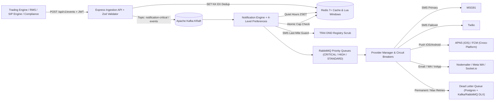
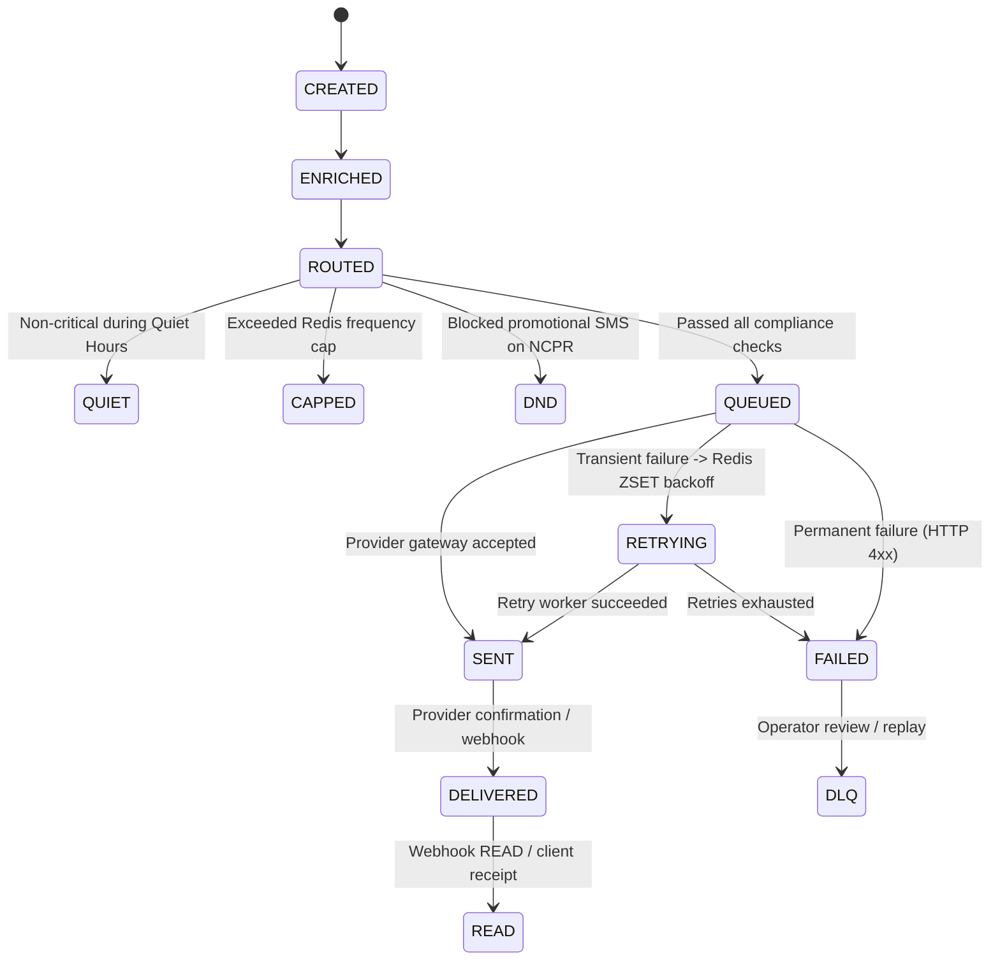

# System Architecture & Diagrams — Event-Driven Notification Engine (BE-6B)

## End-to-End Event Flow (Mermaid)

## Notification State Machine Transitions

## Key Architectural Guarantees

- **Fallback Honesty**: PostgreSQL, Redis, Kafka, and RabbitMQ use real drivers (`pg`, `ioredis`, `kafkajs`, `amqplib`) when brokers are reachable and transparently degrade to synchronized in-memory adapters (`IN_MEMORY_FALLBACK` reported on `/health`) if external containers are offline.
- **No Unattended Live Carrier Spend**: Outbound REST calls to MSG91, Twilio, FCM, WhatsApp, and live SMTP are gated behind `ENABLE_REAL_PROVIDERS=true` and non-test credentials.
