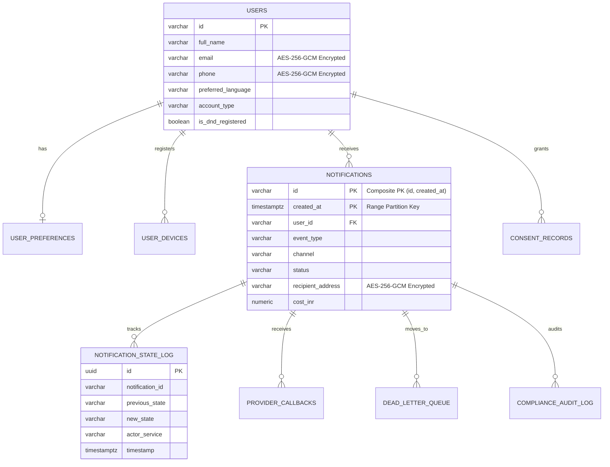

# Database Schema, Partitioning, Indexes & Query Plan Analysis

## Entity-Relationship Diagram (Mermaid)



## Partitioning Strategy & Indexes (`001` & `002` Migrations)

1. **Monthly Range Partitioning (`PARTITION BY RANGE (created_at)`)**:
   - **Composite Primary Key (`PRIMARY KEY (id, created_at)`)**: Resolves Specification Error 1 where PostgreSQL requires every unique/primary key constraint on a partitioned table to include the partition column.
   - **Active & Default Partitions**: `notifications_2026_10`, `notifications_2026_11`, `notifications_2026_12`, `notifications_2027_01`, and `notifications_default` ensure writes never fail on future timestamps.
2. **Indexing Design**:
   - `BRIN` index on `notifications(created_at)` for ultra-compact chronological range scans (`pages_per_range = 32`).
   - Composite `B-Tree` index `(user_id, status, channel)` for per-user audit queries.
   - `GIN` index on `notifications(personalisation_data)` for dynamic JSONB payload lookups.
   - Partial index on `dead_letter_queue(failed_at) WHERE status = 'PENDING_REVIEW'`.

## Daily Delivery-Rate Query & EXPLAIN ANALYZE Analysis

```sql
EXPLAIN ANALYZE
SELECT
  date_trunc('day', created_at) AS delivery_day,
  channel,
  COUNT(*) AS total_notifications,
  COUNT(*) FILTER (WHERE status IN ('DELIVERED', 'READ')) AS delivered_count,
  ROUND((COUNT(*) FILTER (WHERE status IN ('DELIVERED', 'READ'))::numeric / NULLIF(COUNT(*), 0)) * 100, 2) AS delivery_rate_pct,
  ROUND(SUM(cost_inr), 2) AS total_cost_inr
FROM notifications
WHERE created_at >= NOW() - INTERVAL '30 days'
GROUP BY 1, 2
ORDER BY 1 DESC, 2;
```

- Exposed programmatically in `DatabaseClient.explainDailyDeliveryQuery()`.
- When executed against PostgreSQL 15+, the query planner performs **Partition Pruning** (scanning only matching monthly partitions and `notifications_default`) and leverages the `BRIN` index on `created_at` before running a HashAggregate + Sort.
